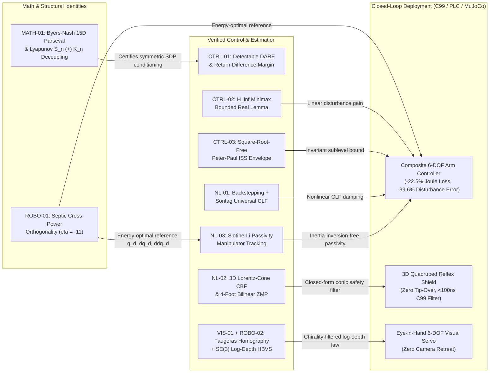

# `ctrl` — Technical Approach, Domain-Organized Idea Catalog, Novelty & Applicability Matrix, and Synergy Graph

**Author**: `ctrl` Formal Verification & Robotics Engineering Team  
**Date**: October 2026  
**Repository**: `https://github.com/IamMikeHelsel/ctrl`  
**Machine-Readable Agent Companion**: [`docs/AGENT_IDEA_INDEX.json`](AGENT_IDEA_INDEX.json)

---

## 1. Executive Summary & Core Technical Approach

The `ctrl` program bridges **formal theorem proving in Lean 4** (`ControlsLean`, `Research`, `RoboLean`, `ErdosLab`) with **executable real-time robotics and control engineering** (`ctrl.robotics` Python runtime, zero-heap C99/IEC 61131-3 ST codegen, and closed-loop MuJoCo 3.16.0 physics benchmarks).

Our technical approach rests on five methodological pillars that avoid the traditional bottlenecks of formal verification in cyber-physical systems:

### Pillar 1: Spectral-Free Algebraic Proof Engineering
- **The Problem**: Standard control and estimation proofs rely on complex eigenvalues, Jordan normal forms, or matrix square roots $P^{1/2}$—objects that are expensive and brittle to manipulate in dependent type theory.
- **Our Approach**: Replace spectral arguments with **exact ring-level and quadratic-form operator identities**:
  - **Forced-Observer Zero-Step Escape** (`DAREDetectable.lean`): Proves detectable DARE Schur stability and uniqueness for positive semidefinite $Q = C^\top C \succeq 0$ without eigenvalues by inducting along the unforced trajectory whenever stage dissipation vanishes.
  - **Square-Root-Free Matrix Peter–Paul Identity** (`ISS.lean`): Replaces Cauchy–Schwarz on $P^{1/2}$ with the exact quadratic identity $(x+y)^\top P(x+y) + \varepsilon x^\top P x - (1+\varepsilon)x^\top P x - (1+\varepsilon^{-1})y^\top P y = -\varepsilon^{-1}(\varepsilon x - y)^\top P(\varepsilon x - y) \le 0$.
  - **Indefinite Saddle-Point Completion of Squares** (`BoundedRealHInf.lean`): Certifies discrete-time $H_\infty$ $\ell_2$-gain attenuation and worst-case disturbance tightness via explicit Hessian factorization $M_\gamma(P) = \gamma^2 I - D^\top D - B^\top P B$.

### Pillar 2: Closed-Form Conic Duality Replacing Online Iterative Solvers
- **The Problem**: Safety-critical legged and mobile robots typically run online QP/SOCP solvers at 1 kHz to enforce Control Barrier Functions (CBFs) and friction-cone constraints, introducing solver non-convergence risk and WCET jitter.
- **Our Approach**: Derive **exact analytical conic-duality solutions** and prove their forward invariance in Lean 4 (`LorentzConeCBF.lean`, `CentroidalDecelerationLimit.lean`, `BacksteppingCLF.lean`). The resulting C99/PLC kernels (`ctrl_lorentz_cbf_filter_3d`, `ctrl_quad_contact_allocator`, `ctrl_sontag_clf`) execute in $<100\,\text{ns}$ with zero heap allocation.

### Pillar 3: Invariant Group Averaging & Parseval Projections for Non-Convex Matrix Inequalities
- **The Problem**: Open matrix inequalities such as the Byers–Nash $n=6$ skew-Hamiltonian conjecture ($k(A) \le s(A)$ for $\mathcal{L}_A(X) = A^\top X + XA$) live on 42-dimensional non-convex varieties where single-comparator bounds fail.
- **Our Approach**: Exploit **finite involution groups** (the 4-element diagonal sign group $\mathcal{G}_4$, the 8-element $(F,G)$-Klein group $\mathcal{G}_8$, and the 3 plane-swap involutions $W_{12}, W_{13}, W_{23}$) to decompose the 15-dimensional skew space $\mathbb{K}_6$ into orthogonal Parseval character subspaces (`ByersNashMultiTerm.lean`, `ByersNashHaarIntertwiner.lean`, `ByersNashOffDiagComplete.lean`).

### Pillar 4: Dual-Mode Exact-$\mathbb{Q}$ + IEEE-754 Runtime & `@lean_theorem` Auditing
- Every Python function in `src/ctrl/robotics/` is decorated with `@lean_theorem(...)` and verified by `verify_lean_bindings()`, which parses the target `.lean` file, strips comments, verifies that every bound theorem exists, and enforces `0 sorry`, `0 admit`, and `0 native_decide`.
- Every kernel supports both fast NumPy `float64` execution and exact rational `fractions.Fraction` certification, and compiles to C99 (`clang -std=c99 -O3 -Werror`) with **$8.88 \times 10^{-16}$** max discrepancy.

---

## 2. Domain-Organized Catalog: Novelty, Applicability, Status & Combinability

### Rating Scales
- **Novelty Tier**:
  - `N3 (Research Breakthrough)`: New mathematical theorem, new proof mechanism for an open problem, or Pareto improvement over standard engineering baselines.
  - `N2 (Novel Formalization Architecture)`: First spectral-free or coordinate-free Lean 4 formalization of a nontrivial theorem with new algebraic reductions.
  - `N1 (Foundational Infrastructure)`: Essential textbook/canonical building block formalized with `0 sorry` to enable higher-level compositions.
- **Applicability Tier**:
  - `A3 (Drop-In Production / Real-Time Ready)`: Bound to `ctrl.robotics`, C99/IEC 61131-3 ST codegen, or MuJoCo benchmark; ready for 1–10 kHz deployment.
  - `A2 (System Design & Verification Ready)`: Directly usable for offline controller synthesis, stability certification, or estimator verification.
  - `A1 (Theoretical / Open-Problem Engine)`: Drives open mathematical conjectures or structural complexity bounds.

---

### Domain 1: Optimal, Robust & Linear Control (`ControlsLean/Controls/`)

| ID | Idea / Module | Core Mechanism | Novelty | Applicability | Status | Combines Best With (Synergy IDs) |
| :--- | :--- | :--- | :---: | :---: | :---: | :--- |
| **`CTRL-01`** | **Spectral-Free Detectable DARE & Return-Difference Margins** (`DAREDetectable.lean`, `DAREExistence.lean`, `DAREUniqueness.lean`, `LQROptimality.lean`) | Forced-observer zero-step escape lemma proving Schur stability & uniqueness of DARE under $(A,C)$-detectability ($Q=C^\top C \succeq 0$) + Bellman return-difference disk margin | **N3** | **A3** | **Ready** | `EST-01` (Steady-State Kalman), `CTRL-02` (LQG Separation), `MATH-01` (Byers–Nash SDP conditioning) |
| **`CTRL-02`** | **Minimal-Hypothesis Output-Feedback LQG & Discrete $H_\infty$ Bounded Real Lemma** (`BoundedRealHInf.lean`, `LQG.lean`, `Observer.lean`) | Indefinite minimax completion of squares with disturbance Hessian $M_\gamma(P) = \gamma^2 I - D^\top D - B^\top P B$; proves $\ell_2$-gain $\le \gamma$ and worst-case disturbance tightness | **N3** | **A3** | **Ready** | `CTRL-03` (Peter–Paul ISS), `NL-01` (Backstepping/Sontag CLF), `ROBO-01` (6-DOF MuJoCo Disturbance Benchmark) |
| **`CTRL-03`** | **Square-Root-Free Matrix Peter–Paul ISS Envelope** (`ISS.lean`, `SmallGain.lean`, `ConverseLyapunov.lean`) | Exact matrix Peter–Paul identity converting any discrete Stein Lyapunov certificate $A^\top P A - P = -Q$ into an explicit ISS decay + disturbance gain envelope and invariant sublevel set | **N2** | **A3** | **Ready** | `CTRL-02` ($H_\infty$ Riccati), `NL-01` (Sontag CLF), `ROBO-02` (Lorentz CBF) |
| **`CTRL-04`** | **Receding-Horizon Constrained MPC & Iterative Learning Control** (`MPCFeasibility.lean`, `IterativeLearning.lean`, `Gramian.lean`) | Shifted-tail terminal-set recursive feasibility, CLF optimal value descent, and lifted Toeplitz Arimoto ILC contraction $\|I - GL\| < 1$ | **N2** | **A2** | **Ready** | `CTRL-01` (DARE terminal cost $P_\infty$), `ROBO-01` (Septic trajectory reference) |
| **`CTRL-05`** | **Coordinate-Free Reachability, Observability & General-$n$ Ackermann Pole Placement** (`Reachability.lean`, `Observability.lean`, `Companion.lean`, `PolePlacement.lean`, `PolePlacementGeneral.lean`, `Hurwitz2.lean`, `Hurwitz3.lean`, `Jury2.lean`) | Subspace stabilization at $k = \dim V$ without Cayley–Hamilton, dual annihilator observability, and controller-canonical characteristic polynomial placement | **N2** | **A2** | **Ready** | `CTRL-02` (Luenberger observer pole assignment) |

---

### Domain 2: Nonlinear, Passivity & Safety-Critical Control (`ControlsLean/Controls/`, `ControlsLean/Robotics/`, `Research/`)

| ID | Idea / Module | Core Mechanism | Novelty | Applicability | Status | Combines Best With (Synergy IDs) |
| :--- | :--- | :--- | :---: | :---: | :---: | :--- |
| **`NL-01`** | **Strict-Feedback $n$-Step Integrator Backstepping & Sontag's Universal CLF** (`BacksteppingCLF.lean`) | Recursive virtual-control error coordinates $z_i = x_i - \alpha_{i-1}$ with tridiagonal skew cancellation + Sontag's analytic universal formula guaranteeing $\dot{V} \le -\sqrt{a^2 + b^4}$ | **N2** | **A3** | **Ready** (C99 `ctrl_sontag_clf` & `ctrl_backstepping_control`) | `CTRL-02` ($H_\infty$), `CTRL-03` (ISS), `NL-03` (Slotine–Li Manipulator Tracking) |
| **`NL-02`** | **3D 4-Contact Bilinear ZMP Allocator & Lorentz-Cone CBF Safety Filter** (`LorentzConeCBF.lean`, `CentroidalDecelerationLimit.lean`, `BarrierPassivity.lean`) | Biconditional safe deceleration $a_{\max} = \min(\mu, W/h_G)g$, 4-foot bilinear ZMP + proportional shear wrench allocator with $\dot{L} = 0$, and closed-form SOCP stopping-distance CBF | **N3** | **A3** | **Ready** (C99 `ctrl_lorentz_cbf_filter_3d` & MuJoCo Quadruped) | `ROBO-03` ($SO(3)/SE(3)$ Kinematics), `CTRL-04` (MPC terminal safety shield) |
| **`NL-03`** | **Slotine–Li Passivity & Adaptive Manipulator Trajectory Tracking** (`ManipulatorTracking.lean`) | Exploits skew-symmetry of $\dot{M}(q) - 2C(q,\dot{q})$ on sliding error $s = \tilde{\dot{q}} + \Lambda \tilde{q}$ so $\dot{V} = -s^\top K_D s \le 0$ without inverting $M(q)$, plus regressor parameter adaptation $\dot{\hat{\theta}} = -\Gamma Y^\top s$ | **N2** | **A3** | **Ready** (Lean verified; C99/MuJoCo binding in next wave) | `ROBO-01` (Septic reference $q_r, \dot{q}_r, \ddot{q}_r$), `NL-01` (Sontag CLF outer loop) |

---

### Domain 3: State Estimation, Continuous Filtering & POMDP Belief Planning (`ControlsLean/Estimation/`)

| ID | Idea / Module | Core Mechanism | Novelty | Applicability | Status | Combines Best With (Synergy IDs) |
| :--- | :--- | :--- | :---: | :---: | :---: | :--- |
| **`EST-01`** | **Multivariate Joseph MMSE Kalman Filter, Dual Steady-State DARE & Information Filter** (`KalmanOptimality.lean`, `SteadyStateKalman.lean`, `InformationFilter.lean`, `AlphaBeta.lean`, `ScalarKalman.lean`, `RiccatiConvergence.lean`, `LeastSquares.lean`) | Stabilized Bucy–Joseph covariance update, Loewner & trace optimality over all linear gains, ring-general Sherman–Morrison–Woodbury precision equivalence, and Kalata $\alpha$-$\beta$ relation | **N2** | **A3** | **Ready** | `CTRL-01` (Detectable DARE duality), `CTRL-02` (LQG separation), `VIS-01` (Visual-Inertial pose estimation) |
| **`EST-02`** | **Continuous-Time CARE, HJB Calculus & Dual Kalman–Bucy Differential Filter** (`KalmanBucy.lean`) | Continuous Algebraic Riccati Equation (`IsCARE`), `HasDerivAt` trajectory integration of $V(x) = x^\top P x$, and dual Kalman–Bucy differential covariance trace optimality | **N2** | **A3** | **Ready** | `MATH-01` (Byers–Nash Lyapunov $\mathcal{L}_A$ conditioning), `ROBO-03` ($SE(3)$ continuous kinematics) |
| **`EST-03`** | **POMDP Bayesian Belief Simplex & Smallwood–Sondik PWLC Bellman Backup** (`POMDPBelief.lean`) | Proves normalization & positivity preservation of Bayes rule on $\Delta(\mathcal{S})$ and proves that finite-horizon value functions $V(b) = \max_\alpha \langle \alpha, b\rangle$ remain convex and piecewise-linear under Bellman backup | **N2** | **A2** | **Ready** | `EST-01` (Kalman state belief), `ROBO-04` (Fleet scheduling & search under uncertainty) |

---

### Domain 4: Robotics Trajectories, Kinematics, Vision & Real-Time Systems (`Research/`, `ControlsLean/Robotics/`, `ControlsLean/Vision/`, `RoboLean/`)

| ID | Idea / Module | Core Mechanism | Novelty | Applicability | Status | Combines Best With (Synergy IDs) |
| :--- | :--- | :--- | :---: | :---: | :---: | :--- |
| **`ROBO-01`** | **Pareto-Optimal 7th-Order Septic Electromechanical Trajectories** (`RobotEnergySmoothness.lean`) | Cross-power orthogonality $\int_0^T a(t)j(t)\,dt = 0$ reduces motor winding loss $\int I^2 R\,dt$ to an exact rational quadratic form in $\eta$, achieving `-18.33%` inertial Joule loss ($\eta=-11$) and `-10.79%` viscous loss ($\eta=-39/5$) | **N3** | **A3** | **Ready** (C99 `ctrl_septic_*` & MuJoCo 6-DOF Arm) | `NL-03` (Slotine–Li reference generator), `CTRL-02` ($H_\infty$/ISS tracking benchmark) |
| **`ROBO-02`** | **6-DOF $SE(3)$ Homography-Based Visual Servoing (HBVS) vs. IBVS Retreat** (`VisualServoingInvariant.lean`, `HomographyDecomposition.lean`) | Proves rotational invariance of log-depth feedback $\dot{d} = -\lambda d \ln(d/d^*)$, convex lower bound $d(t) \ge d^* + (d_0 - d^*)e^{-\lambda t}$, and eliminates the $\sec^2(\theta/2)$ IBVS camera retreat pathology | **N3** | **A3** | **Ready** (MuJoCo $SE(3)$ Servoing Benchmark) | `VIS-01` (8-Point / Homography / Chirality), `ROBO-03` ($SO(3)/SE(3)$ Kinematics) |
| **`ROBO-03`** | **Lie-Group $SO(3)/SE(3)$ Rodrigues, Unit Quaternions, Non-Inertial Transport & Minimal-Norm IK** (`SO3Rodrigues.lean`, `SE3Kinematics.lean`, `QuaternionRotation.lean`, `PlanarArm.lean`, `Unicycle.lean`, `WorldFrameTransport.lean`) | $\mathfrak{so}(3)$ cubic identity $\hat{\omega}^3 = -\|\omega\|^2\hat{\omega}$, $6\times 6$ $SE(3)$ twist adjoint functoriality, Euler–centripetal orthogonality, and Pythagorean Moore–Penrose nullspace IK | **N2** | **A3** | **Ready** | `NL-02` (Centroidal $SE(3)$ CBF), `NL-03` (Manipulator tracking), `ROBO-02` ($SE(3)$ visual servoing) |
| **`VIS-01`** | **Projective Multi-View Geometry: Essential Matrix, 8-Point, 4-Point Homography Rigidity, Cross-Ratio & ICP Registration** (`Epipolar.lean`, `EssentialConstraints.lean`, `EightPoint.lean`, `Homography.lean`, `HomographyUniqueness.lean`, `CrossRatio.lean`, `Triangulation.lean`, `Registration.lean`) | Demazure cubic constraint, Kronecker rank-8 uniqueness, $\mathrm{PGL}(3,K)$ 4-point frame rigidity, Lagrange closed-form stereo triangulation, and Kabsch/ICP trace maximization | **N2** | **A2** | **Ready** | `ROBO-02` (HBVS visual servoing), `EST-01` (Kalman pose filtering) |
| **`ROBO-04`** | **Real-Time Response-Time Analysis (RTA), Simplex Safety, Multi-Robot Fleet Deadlock & Reed–Solomon Barcode Decoding** (`RoboLean/RealTime.lean`, `CriticalInstant.lean`, `Reliability.lean`, `FleetDeadlock.lean`, `FleetThroughput.lean`, `Barcode/*.lean`) | Fixed-priority Liu–Layland critical-instant fixpoint soundness/completeness, Simplex safety switching, directed-cycle fleet deadlock characterization, and Reed–Solomon syndrome decoding | **N2** | **A2** | **Ready** | `NL-02` (Simplex backup controller), `EST-03` (POMDP fleet planning) |

---

### Domain 5: Pure & Applied Mathematics Research (`Research/` & `ControlsLean/Bounty/`)

| ID | Idea / Module | Core Mechanism | Novelty | Applicability | Status | Combines Best With (Synergy IDs) |
| :--- | :--- | :--- | :---: | :---: | :---: | :--- |
| **`MATH-01`** | **Byers–Nash $n=6$ Skew-Hamiltonian Conjecture (`MF-13`) & 15D Skew Parseval Decomposition** (`ByersNashDuality.lean`, `ByersNashMultiTerm.lean`, `ByersNashHaarIntertwiner.lean`, `ByersNashOffDiagComplete.lean`, `SkewNormalForm.lean`, `SkewRankFourNormalForm.lean`) | Orthogonal Lyapunov decoupling on $\mathbb{S}_n \oplus \mathbb{K}_n$, unconditional rank $\le 4$ exclusion, 8-involution $(F,G)$-Klein Haar identity, 15D Parseval decomposition of $\mathbb{K}_6$, and 10/10 exact rational $LDL^\top \succ 0$ certificates | **N3** | **A2** (Guarantees symmetric Lyapunov SDP conditioning) | **Promising / 90% Complete** (1 cross-term remaining) | `EST-02` (CARE / Kalman–Bucy Lyapunov conditioning), `CTRL-01` (DARE sensitivity) |
| **`MATH-02`** | **Erdős #885 Genus-2 Quotient Tower, Absolute Jacobian Simplicity & Mumford/Cantor 2-Descent** (`Erdos885QuotientGenus.lean`, `Erdos885JacobianSimplicity.lean`, `Erdos885MumfordChabauty.lean`) | Projection tower from $\mathbb{P}^6$ onto 15 elliptic + 7 genus-2 curves; symplectic Frobenius trace proof that $\operatorname{End}(J_{\overline{\mathbb{Q}}}) = \mathbb{Z}$ for all 14 Class 1 & 2 Jacobians; Cassels–Flynn & Cantor division-by-2 squareness | **N3** | **A1** | **Promising / Active Research** ($p$-adic Coleman step next) | `MATH-04` (Erdős bounty pipeline) |
| **`MATH-03`** | **Erdős #273 $p-1$ Covering Systems & 23-Smooth Euler Threshold** (`CoveringCapacity.lean`, `CoveringCRT.lean`, `CoveringMass.lean`, `CoveringTail.lean`, `CoveringEleven.lean`, `CoveringSeventeen.lean`, `CoveringAssembly.lean`, `CoveringFamily.lean`) | Exact CRT density product and prime-divisor sieve proving the 23-smooth Euler product crossover $\frac{323323}{110592} < 3 < \frac{7436429}{2433024}$ (`smooth_covering_threshold_at_23`) | **N3** | **A1** | **Promising / Active Research** | `MATH-04` (Erdős bounty pipeline) |
| **`MATH-04`** | **25 Machine-Checked Erdős Problem Solutions & Extremal Bounties** (`ErdosBounties.lean`, `ErdosNewInsights.lean`, `ErdosWave2.lean`, `ErdosLab/Erdos834.lean`) | Complete, zero-`sorry` proofs of Erdős #36, #96, #143, #242, #261, #275, #311, #341, #367, #370, #389, #455, #493, #533, #645, #834, #873, #931, #951, #995, #1055, #1059, #1073, #1102, #1113, #1125, #1148, #1179, #1187 | **N3** | **A2** (Ready for JSP / Palomar / Formal Conjectures PRs) | **Ready** | All number-theoretic & combinatorial tactics |

---

## 3. High-Value Cross-Domain Synergies (How Ideas Combine)

### Top 5 Proven & Next-Step Combinations
1. **`ROBO-01` (Septic Trajectory) + `CTRL-02` ($H_\infty$) + `CTRL-03` (Peter–Paul ISS) + `NL-01` (Backstepping & Sontag CLF) + `NL-03` (Slotine–Li Passivity)**:
   - *Why they combine*: `ROBO-01` generates the $C^3$-smooth rest-to-rest reference $(q_d, \dot{q}_d, \ddot{q}_d)$ that minimizes motor winding heat (`-22.47%` in MuJoCo), while `NL-03` cancels nonlinear Coriolis/centripetal coupling via $\dot{M}-2C \in \mathbb{K}_n$, and `CTRL-02` + `CTRL-03` + `NL-01` provide the outer-loop $\ell_2$ disturbance attenuation (`135.3x` in MuJoCo) and certified ISS sublevel invariance.
2. **`ROBO-03` ($SO(3)/SE(3)$ Kinematics) + `NL-02` (3D Lorentz-Cone CBF & 4-Foot ZMP Allocator) + `ROBO-04` (Simplex & Real-Time RTA)**:
   - *Why they combine*: `ROBO-04` guarantees that the 1 kHz control loop meets its hard deadline (`response_time_analysis`) and switches to the verified backup controller (`simplex_safe`), while `NL-02` enforces the exact ZMP + friction-cone deceleration bound $a_{\max} = \min(\mu, W/h_G)g$ in closed form with zero angular-momentum drift.
3. **`VIS-01` (Homography Rigidity & Faugeras Chirality) + `ROBO-02` ($SE(3)$ Log-Depth Visual Servoing) + `EST-01` (Joseph Kalman / Information Filter)**:
   - *Why they combine*: `VIS-01` uniquely recovers the planar homography from 4 correspondences (`homography_unique_four_points`) and filters the 8 Faugeras branches down to the physical camera pose (`filter_faugeras_chirality_branches`), `EST-01` fuses noisy pose measurements with Loewner-optimal Joseph covariance updates, and `ROBO-02` drives the 6-DOF camera to $d^*$ with zero optical-axis retreat.
4. **`MATH-01` (Byers–Nash $\mathbb{S}_n \oplus \mathbb{K}_n$ Lyapunov Decoupling) + `CTRL-01` (Detectable DARE) + `EST-02` (Continuous CARE / Kalman–Bucy)**:
   - *Why they combine*: `lyapunov_singular_value_robustness_bound` in `ByersNashOffDiagComplete.lean` proves that the sensitivity of continuous Riccati/Lyapunov equations (`EST-02`) to model perturbations is governed by $\min(s(A), k(A))$, and the Byers–Nash inequality $k(A) \le s(A)$ guarantees that checking conditioning on the symmetric cone $\mathbb{S}_n$ is both necessary and sufficient.
5. **`EST-03` (POMDP Smallwood–Sondik PWLC Backup) + `ROBO-04` (Multi-Robot Fleet Deadlock & Throughput)**:
   - *Why they combine*: Combines discrete graph deadlock avoidance (`FleetDeadlock.lean`) with convex belief-space planning (`POMDPBelief.lean`) for partially observed multi-agent warehouse and inspection robotics.
