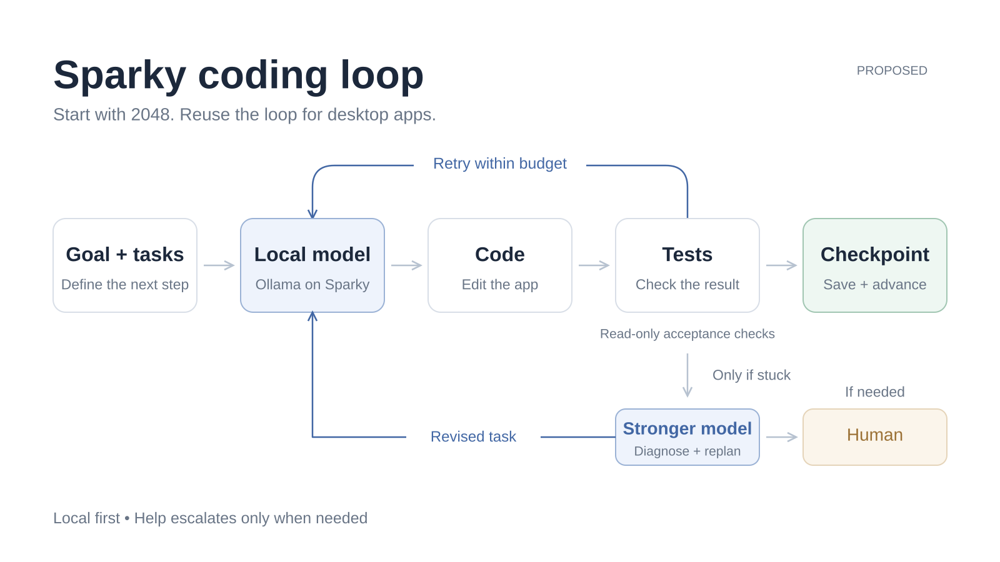

# Sparky coding loop

This is the approved single-slide diagram for the Sparky local-development experiment. The local worker implements a small task; read-only acceptance checks determine whether to checkpoint or return diagnostics within a fixed retry budget. When the worker is stuck, a stronger model diagnoses or revises the task and returns it through the same acceptance boundary. Human input remains available for permissions, scope, unresolved ambiguity, and final product acceptance.

The first pilot is 2048. Inference, Rust compilation, and game execution run on Sparky. Cloud assistance supplies contracts, orchestration, and independent checks, and must be logged separately from local-model implementation. A passing test suite is not a substitute for visual inspection and a human play test, and one game does not establish a general autonomous development capability.

- [Editable Excalidraw source](assets/sparky-coding-loop.excalidraw)
- Pilot environment and evidence on Sparky: `/home/mike/local-dev-pilot-20261017`
- These assets are the revised `sparky-coding-loop-slide(1)` files approved on 2026-10-17, including the stronger-model branch and revised-task return arrow.

This documentation addition does not change the Lean research workflow or any frozen challenge statement. Keep the repository private; nothing here authorizes publishing it.
